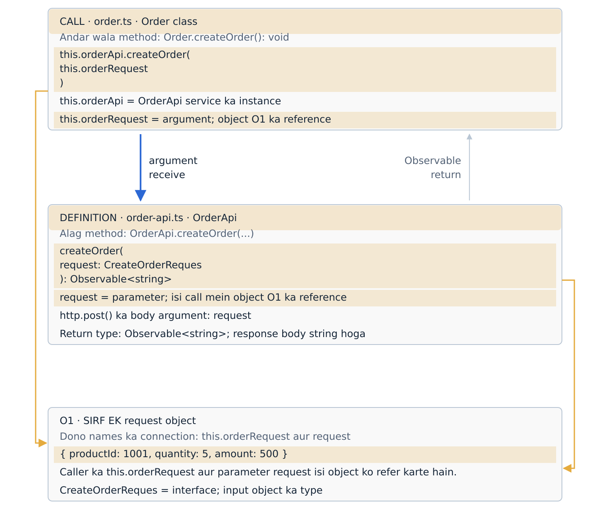
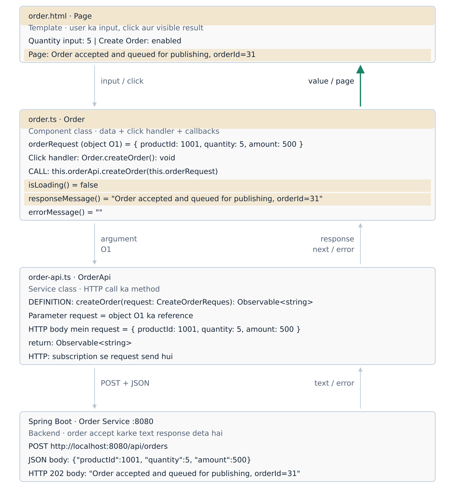

# Angular order flow · call, argument, parameter and response

[Back to the notes index](../README.md) · [Kafka and database flow](Visual_Order_Database_Flow.md)

[](https://aryan-kafka-flow-lab.alexsaifee786.chatgpt.site/angular-order-flow.html)

The interactive flow opens at **step 4: call and parameter**. Use **Pichhla** to see where the initial object is created; use **Agla** for the Observable, HTTP request, callbacks and page update. The last two steps explain `ngModel` and the quantity control reference.

**Offline:** [Download Angular_Order_Request_Flow.html](https://github.com/alexsaifee786-jpg/project-notes-kafka-ci-cd/raw/refs/heads/main/assets/angular-order-flow/Angular_Order_Request_Flow.html) and open it in Chrome or Edge. GitHub shows images and source; the button opens the working controls. The replay uses sample values and sends no backend requests.

## The connection to remember

[](https://aryan-kafka-flow-lab.alexsaifee786.chatgpt.site/angular-order-flow.html)

[Zoomable SVG](../assets/angular-order-flow/argument-parameter-map.svg)

**Call mein `this.orderRequest` bhejte hain. Service method ke andar usi object ko parameter `request` se access karte hain. Dono names same hona zaroori nahi hai.**

### Caller: order.ts

```typescript
this.orderApi.createOrder(this.orderRequest)
```

| Part | Type | Purpose |
|---|---|---|
| `this` | Current component instance | Refers to the current `Order` instance. |
| `this.orderApi` | Service instance held in a property | Provides the `OrderApi` methods. |
| `.createOrder(...)` | Method call | Calls the service's method. |
| `this.orderRequest` | Argument expression | Supplies the existing request object. |

### Receiver: order-api.ts

```typescript
createOrder(request: CreateOrderReques): Observable<string> {
  return this.http.post(
    'http://localhost:8080/api/orders',
    request,
    { responseType: 'text' }
  );
}
```

| Part | Type | Purpose |
|---|---|---|
| `createOrder(...) { ... }` | Method definition | Defines the service method's input and behavior. |
| `request` | Parameter | Receives the argument's object reference for this call. |
| `CreateOrderReques` | Interface | Describes the input object's fields. |
| `Observable<string>` | Return type | Describes a stream that delivers a string response body. |
| `request` inside `http.post()` | Body argument | Supplies the received object to HttpClient. |

**O1 is a teaching label for one frontend JavaScript object.** The component's `this.orderRequest` and this invocation's `request` parameter refer to O1; defining the parameter does not create another order object. The object reference is supplied as the argument value. HttpClient serializes the object's data as JSON for HTTP; the backend receives JSON and creates its own Java request DTO.

`CreateOrderReques` is the interface spelling currently used in the shared project code.

## Two methods with the same name

| Class | Method | Trigger | Return type |
|---|---|---|---|
| `Order` component | `createOrder()` | `(click)="createOrder()"` in its template | `void` |
| `OrderApi` service | `createOrder(request)` | `this.orderApi.createOrder(this.orderRequest)` in the component | `Observable<string>` |

`void` belongs to the component method. The service returns the Observable to the component. The backend response later enters the registered `next` callback; it is not returned by the component's `void` method.

## Initial object and user input

The component creates this object as a class property when Angular creates the component instance:

```typescript
protected orderRequest: CreateOrderReques = {
  productId: 1001,
  quantity: 2,
  amount: 500
};
```

The interface describes the shape; the object literal above creates the data. The replay changes quantity from `2` to `5` through the input. The same object O1 then contains `{ productId: 1001, quantity: 5, amount: 500 }`. Changing quantity alone does not automatically recalculate the separate `amount` property.

## Request and response sequence

[](https://aryan-kafka-flow-lab.alexsaifee786.chatgpt.site/angular-order-flow.html)

[Zoomable SVG](../assets/angular-order-flow/order-http-flow.svg)

| Step | Location | What happens |
|---|---|---|
| 1 | `order.ts` | Component property initialization creates `orderRequest`. |
| 2 | `order.html` and `order.ts` | The input displays `2`; entering `5` updates `orderRequest.quantity` through two-way binding. |
| 3 | `order.html` to `order.ts` | Clicking Create Order calls the component's `createOrder()`; it clears old messages and sets loading to `true`. |
| 4 | `order.ts` to `order-api.ts` | `this.orderRequest` is the argument; service parameter `request` refers to the same object. |
| 5 | `order-api.ts` to `order.ts` | `http.post()` creates an `Observable<string>`; the service returns it. No HTTP request has been sent at this logical point before subscription. |
| 6 | `order.ts`, HttpClient and backend | `.subscribe(...)` on that Observable sends the POST request; the object body is serialized as JSON. |
| 7 | Backend to component callback | The successful HTTP response body enters `next` as the string parameter `response`. |
| 8 | `order.ts` to `order.html` | `.set(response)` stores the text in the signal; the template reads `responseMessage()` and shows it. Loading becomes `false`. |
| Alternative | Component error callback | A network or HTTP failure enters `error`; the error signal is set and loading becomes `false`. |

Steps 4–6 zoom into one chained expression. The real code runs the service call and subscribes immediately in sequence:

```typescript
this.orderApi.createOrder(this.orderRequest).subscribe({
  next: response => {
    console.log('Response:', response);
    this.responseMessage.set(response);
    this.isLoading.set(false);
  },
  error: error => {
    console.log('Order faild:', error);
    this.errorMessage.set('Order request failed. Please try again.');
    this.isLoading.set(false);
  }
});
```

**Returned Observable and emitted response are different values:** `return this.http.post(...)` returns the Observable immediately. Later, `next` receives the backend text, for example `Order accepted and queued for publishing, orderId=31`.

The service uses `{ responseType: 'text' }`, so the emitted response body is a primitive `string`. The request body remains JSON. `Observable<string>` describes the response type, while `CreateOrderReques` describes the input object type.

## Signal to template

Inside the component:

```typescript
this.responseMessage.set(response);
this.isLoading.set(false);
```

In the template:

```html
<p>{{ responseMessage() }}</p>
```

`response` is the callback parameter containing the backend's string. `responseMessage` is the component's signal storing that string. `responseMessage()` reads its current value for the page.

**HTTP 202 means the backend accepted and queued the order.** This request's loading state ends after the HTTP response; it does not wait for Kafka and Inventory to finish. See the [separate database flow](Visual_Order_Database_Flow.md) for the asynchronous result.

## NgModel after the full flow

**NgModel is an Angular directive that synchronizes a form control with component data and exposes control state.** It is available through `FormsModule`.

```html
<input
  type="number"
  [(ngModel)]="orderRequest.quantity"
  required
  min="1"
  #quatityInput="ngModel">
```

| Code or state | Meaning |
|---|---|
| `[(ngModel)]="orderRequest.quantity"` | Component value goes into the input; user edits update the same property. |
| `[ngModel]="orderRequest.quantity"` | The value-binding half of the two-way binding. |
| `(ngModelChange)="orderRequest.quantity = $event"` | The change-event half; assigns the edited value to the property. |
| `#quatityInput="ngModel"` | Creates a template reference to this input's NgModel directive. |
| `quatityInput.invalid` | Reports whether validation fails, such as quantity `0` with `min="1"`. |
| `quatityInput.touched` | Becomes true after the input has been focused and blurred. |

`quatityInput` is the local name used in the shared template. Keep that spelling consistent wherever it is referenced. The export name `"ngModel"` is fixed.

## One-line definitions

| Concept | Definition |
|---|---|
| Argument | An argument is a value supplied when calling a method. |
| Parameter | A parameter is a named variable that receives an argument in a method. |
| Interface | An interface describes the structure a value must satisfy. |
| Service | A service is a class used to share application logic or data access. |
| Observable | An Observable represents a stream that can deliver values to subscribers. |
| Callback | A callback is a function supplied for another operation to invoke. |
| Signal | A signal holds a value and notifies its dependents when that value changes. |
| Two-way binding | Two-way binding keeps a control's value and component data synchronized in both directions. |

## Official references

- [TypeScript: functions and parameter types](https://www.typescriptlang.org/docs/handbook/2/functions.html)
- [Angular: making HTTP requests, response types and subscription](https://angular.dev/guide/http/making-requests)
- [Angular: two-way binding with form controls](https://angular.dev/guide/templates/two-way-binding)
- [Angular: NgModel and template reference](https://angular.dev/api/forms/NgModel)

Learning supplement based on the shared code, 16 October 2026. The replay is local and illustrative; quantity `5`, object label `O1` and order ID `31` explain data flow. The existing compiled Kafka notes PDF remains unchanged.
