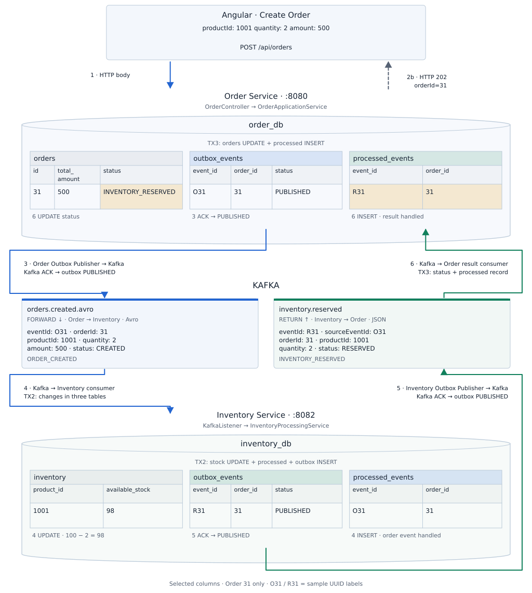

# Visual walkthrough · Angular, Kafka and both databases

[Back to the notes index](../README.md)

## Open the interactive flow

[](https://aryan-kafka-flow-lab.alexsaifee786.chatgpt.site/database-flow.html)

Click the button, then press **Agla** to move from step 0 through the flow. **Pichhla** moves back; the dropdown jumps to any step. The page is private to your ChatGPT account.

GitHub's image preview cannot run these controls. The button and the diagram below open the interactive page.

**Offline copy:** [Download the HTML](https://github.com/alexsaifee786-jpg/project-notes-kafka-ci-cd/raw/refs/heads/main/assets/order-flow/Kafka_Order_Platform_Interactive_Flow.html), then double-click the saved file to open it in Chrome or Edge. It starts at step 0, works offline and does not send backend requests.

## One-page diagram

[](https://aryan-kafka-flow-lab.alexsaifee786.chatgpt.site/database-flow.html)

[PNG image](../assets/order-flow/order-database-flow.png) · [SVG for zooming](../assets/order-flow/order-database-flow.svg)

## Example request

```json
{
  "productId": 1001,
  "quantity": 2,
  "amount": 500
}
```

This learning replay follows **order 31** with starting stock **100** and final stock **98**. It shows selected columns and rows for this order; other existing rows are omitted. **O31** and **R31** are short sample labels for two different event UUIDs.

## What changes at each step

| Step | Action | Database change |
|---|---|---|
| 0 | Before this request | Inventory product 1001 has stock 100; this order's rows do not exist yet. |
| 1 | Angular sends `POST /api/orders` | The JSON body reaches Order Service on port 8080. |
| 2 · TX1 | Order Service accepts the order | In one transaction: insert `orders` row 31 with status `pending` and an `outbox_events` row for O31 with status `PENDING`. The HTTP response is `202 Accepted` with the order ID. |
| 3 | Order publisher sends O31 to `orders.created.avro` | After Kafka acknowledges the send, Order's outbox row becomes `PUBLISHED`. |
| 4 · TX2 | Inventory consumes O31 | In one transaction: stock becomes `100 − 2 = 98`; insert O31 into Inventory's `processed_events`; insert result R31 into Inventory's `outbox_events` as `PENDING`. |
| 5 | Inventory publisher sends R31 to `inventory.reserved` | After Kafka acknowledges the send, Inventory's outbox row becomes `PUBLISHED`. |
| 6 · TX3 | Order consumes R31 | In one transaction: update order 31 to `INVENTORY_RESERVED` and insert R31 into Order's `processed_events`. |

The publishers poll their own outbox tables. A Kafka send acknowledgement confirms publication; it does not mean the other service has finished processing. Consumers acknowledge after their database transaction succeeds.

**HTTP 202 means accepted:** the final reservation result returns asynchronously through Kafka. This flow does not show a later HTTP response or an automatic final-status refresh in Angular.

## The six tables

| Database | Table | One-line meaning |
|---|---|---|
| `order_db` | `orders` | Stores the order and its current business status. |
| `order_db` | `outbox_events` | Stores outgoing Order events waiting for publication or already published. |
| `order_db` | `processed_events` | Records incoming Inventory result event IDs already handled by Order. |
| `inventory_db` | `inventory` | Stores each product's available stock. |
| `inventory_db` | `outbox_events` | Stores outgoing Inventory result events waiting for publication or already published. |
| `inventory_db` | `processed_events` | Records incoming Order event IDs already handled by Inventory. |

**Identity:** O31 is the original order event; R31 is the new reservation result with `sourceEventId = O31`; both refer to `orderId = 31`.

**Duplicate event:** receiving the same event ID again skips its business effect. Submitting the Angular form again creates a new order.

This is the sufficient-stock path. An insufficient-stock decision returns on `inventory.reservation.failed` and leads to `INVENTORY_REJECTED`; see Chapter 07.

## Related concepts

- [Chapter 03 · Order transaction and polling outbox](03-Order_Transactional_Outbox.md)
- [Chapter 04 · Inventory transaction, idempotency and manual ACK](04-Inventory_Idempotency_Manual_ACK.md)
- [Chapter 07 · Result events and final order status](07-Inventory_Results_Order_Lifecycle.md)
- [Chapter 17 · Run a correlated local demo](17-Local_Demo_Interview_Walkthrough.md)

Implementation reference: [Kafka Order Platform at revision 2bad80e88cf7](https://github.com/alexsaifee786-jpg/kafka-order-platform/tree/2bad80e88cf7b0f7b4dd77359287b04ef6403537). Supplement added 15 October 2026. The existing compiled PDF remains the September edition.


